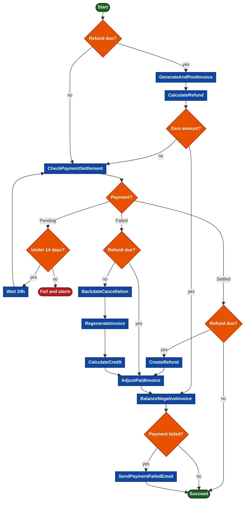

# cancellation-api

Cancels subscriptions and refunds the customer when a refund is due, in line with the DMCC Act cooling-off and refund rules.
It has two parts:

1. **Cancellation API**: an API Gateway Lambda that cancels a subscription on request.
2. **Refund workflow**: a Step Functions state machine, started by the cancellation API, that handles the parts that
   can take days: waiting for payment settlement, refunding, balancing invoices, and dealing with Direct Debits that fail to settle.

This replaces product-move-api's `RefundHandler` (SQS `product-switch-refund-{stage}`) and its use of invoicing-api `/refund`.
The refund rules are carried over unchanged. In practice only Supporter Plus is refund-eligible to begin with.

## Status

| Part | Status |
|---|---|
| Cancellation API | WIP in [#3946](https://github.com/guardian/support-service-lambdas/pull/3946): routing, validation, docs and local serving. Both endpoints return a fixed example; no Zuora calls, emails or events yet |
| Refund workflow | In progress: `calculateRefund` is a placeholder that validates its input and then fails. Other Lambdas and the state machine are still to come |

## Cancellation API

TODO

## Refund workflow

The workflow assumes the subscription is already cancelled. It never re-checks refund eligibility and never sends the
confirmation email or event.

1. If a refund is due: generate and post the cancellation (negative) invoice and calculate the refund.
2. Wait for the payment to settle, checking daily for up to 14 days. If it still hasn't settled, the execution fails
   and raises an alarm.
3. Once settled: refund the customer if a refund is due, then balance the invoices.
4. If a Direct Debit fails to settle:
   - when no refund is due, backdate the cancellation to the start of the unpaid period, so the customer doesn't get
     that period free
   - in all cases, balance the invoices and send `cancelled-payment-email`

Each Lambda checks Zuora for completion before acting, so any step can safely be re-run and no datastore is needed.
See the issue below for the state diagram and the detailed rules.

### Flow Diagram

## Alarms

Alarms go to Lifecycle via alarms-handler.

| Alarm | Raised when | Status |
|---|---|---|
| Cancellation API errors | TODO | TODO |
| Refund workflow could not be started | `StartExecution` fails | TODO |
| Refund workflow failed | an execution fails, times out or is aborted: a customer not refunded, or a failed DD not acted on | TODO |

## References

- Refund workflow design and delivery plan: https://github.com/guardian/support-service-lambdas/issues/3942
- [Asana epic](https://app.asana.com/1/1210045093164357/project/1213134855566811/task/1220070924460390)
- [Design doc: DMCCA cancellation and refunds](https://docs.google.com/document/d/1HD8KhUndfSspOoB3vf5749eUqPZ4S-LkumFwM-CB-7Y/edit?tab=t.0)
- [DMCC cooling off and refund tables](https://docs.google.com/spreadsheets/d/16WsRtjNOTizvmmH_LKQDocn7K5AAim2j3N6hoMAnJp0/edit?gid=0#gid=0)
- [Zuora Orders API](https://developer.zuora.com/v1-api-reference/api/orders/)
- [Hono Zod OpenAPI](https://hono.dev/examples/zod-openapi)
- [AWS Step Functions developer guide](https://docs.aws.amazon.com/step-functions/latest/dg/welcome.html)
