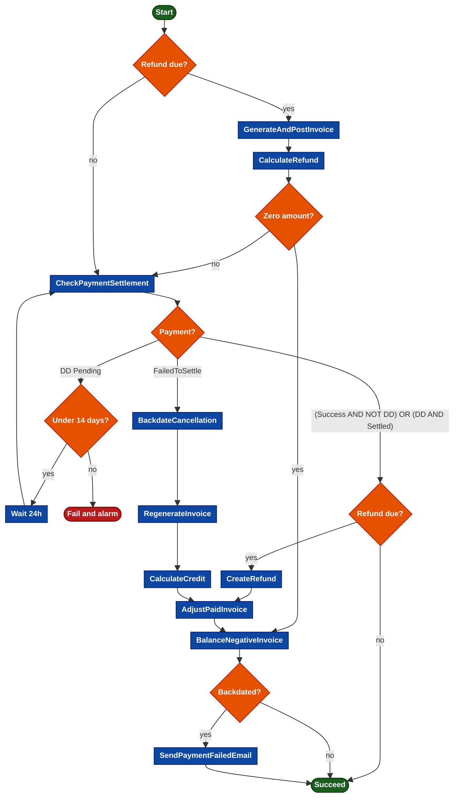

# Cancellation API handler

## Overview

This handler contains
1. a Subscription cancellation API inside `src/cancel/`, and
2. a state machine for refunding in `src/refund`

### 1. Cancellation API

**WIP:** routing, request validation, documentation and local serving are
implemented. Both POST endpoints currently return the fixed
`{ "type": "hard", "willRefund": false }` example. Zuora/ownership checks,
cancellation, emails and events are not implemented; do not connect real
customer journeys yet.

| Operation | Path |
| --- | --- |
| Preview | `/subscriptions/{subscriptionNumber}/preview-cancellation` |
| Execute | `/subscriptions/{subscriptionNumber}/cancel` |
| Generated OpenAPI | `/openapi.json` |
| Interactive API explorer | `/explorer` |

The explorer and OpenAPI contract are public. API Gateway validates API keys for
operations; the app validates the identity header and request shape.
Local operation requests need `x-identity-id` but no API Gateway key.

### Local development and testing

```sh
pnpm --filter cancellation-api local
# Open http://localhost:8787/explorer

curl -X POST http://localhost:8787/subscriptions/A-S12345678/preview-cancellation \
  -H 'Content-Type: application/json' -H 'x-identity-id: 123456789' -d '{}'

pnpm --filter cancellation-api test
pnpm --filter cancellation-api type-check
pnpm --filter cancellation-api fix-formatting
pnpm --filter cancellation-api lint --fix
pnpm --filter cancellation-api cdk:test
```

When deployed, base URLs are
https://cancellation-api-code.support.guardianapis.com and
https://cancellation-api.support.guardianapis.com. The explorer and API calls
use the same origin, including when accessed through an API Gateway stage URL.

OpenAPI and the interactive explorer are generated from the schemas; there is no
separate YAML contract to maintain.

## 2. Refund workflow

In progress: `calculateRefund` is a placeholder that validates its input and
then fails. Other workflow Lambdas and the state machine are still to come.
The planned workflow replaces product-move-api's `RefundHandler`
(SQS `product-switch-refund-{stage}`) and its use of invoicing-api `/refund`.
Refund rules are carried over unchanged; initially only S+ is refund-eligible.

The workflow assumes the subscription is already cancelled. It never re-checks refund eligibility and never sends the
confirmation email or event.

1. If a refund is due: post the cancellation (negative) invoice and calculate the refund, which is the total of the
   invoice being refunded (charges plus tax).
2. Find the latest payment on that invoice (or, if no refund is due, on the latest positive invoice).
3. If it's a pending Direct Debit, wait for it to settle, checking daily; after 14 days, fail and alarm.
4. If it succeeded: refund if due, then balance the invoices.
5. If a Direct Debit fails to settle, backdate the cancellation to the start of the unpaid period (never later), balance
   the invoices, and send `cancelled-payment-email` if it was backdated.

Every step is safe to re-run: each Lambda checks Zuora for its own completed work first. Zuora idempotency keys aren't
used because they expire after 24 hours and cache failures.
See the issue below for the detailed rules.

### Flow Diagram


## Alarms

Alarms go to Lifecycle via alarms-handler.

| Alarm | Raised when | Status |
|---|---|---|
| Cancellation API errors | the API returns a 5xx, including when the refund workflow can't be started (`StartExecution` fails) | API Gateway 5xx alarm configured; workflow startup not implemented |
| Refund workflow failed | an execution fails, times out or is aborted: a customer not refunded, or a failed DD not acted on | TODO |


## References

- Refund workflow design and delivery plan: https://github.com/guardian/support-service-lambdas/issues/3942
- [Asana epic](https://app.asana.com/1/1210045093164357/project/1213134855566811/task/1220070924460390)
- [Design doc: DMCCA cancellation and refunds](https://docs.google.com/document/d/1HD8KhUndfSspOoB3vf5749eUqPZ4S-LkumFwM-CB-7Y/edit?tab=t.0)
- [DMCC cooling off and refund tables](https://docs.google.com/spreadsheets/d/16WsRtjNOTizvmmH_LKQDocn7K5AAim2j3N6hoMAnJp0/edit?gid=0#gid=0)
- [Zuora Orders API](https://developer.zuora.com/v1-api-reference/api/orders/)
- [Hono Zod OpenAPI](https://hono.dev/examples/zod-openapi)
- [Hono AWS Lambda adapter (`@hono/aws-lambda`)](https://hono.dev/docs/getting-started/aws-lambda)
- [Scalar HTML integration](https://scalar.com/products/api-references/getting-started)
- [Proof of concept #3610](https://github.com/guardian/support-service-lambdas/pull/3610)
- [AWS Step Functions developer guide](https://docs.aws.amazon.com/step-functions/latest/dg/welcome.html)
