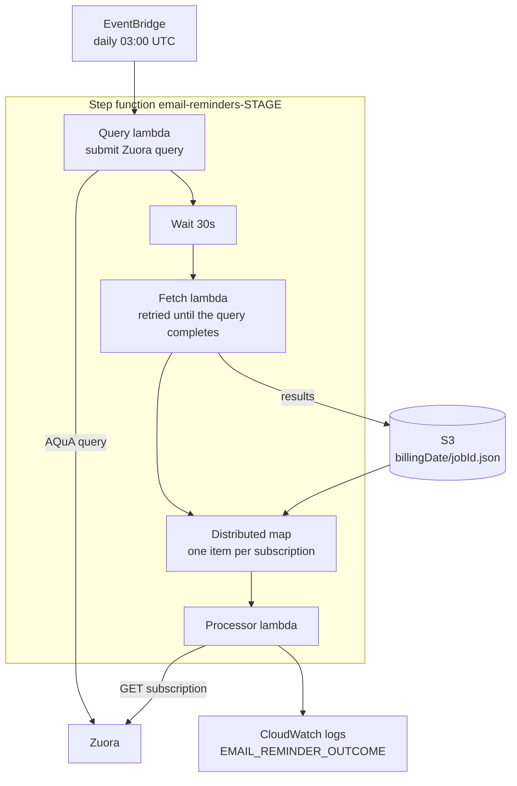

# email-reminders

Works out which reminder or notice email, if any, each UK subscriber is due 14 days before their subscription bills.

Current status: work in progress. No emails are sent; the processor only logs what it would send.

## How it works

A step function, `email-reminders-STAGE`, runs daily at 03:00 UTC, a quiet period that avoids the bill run and payment run times.



1. The query lambda (`email-reminders-query-STAGE`) submits a Zuora AQuA query for charges with a charged through date on the billing date, on active, auto-renewing subscriptions whose Sold To contact is in the UK. The billing date is 14 days after the date being processed: today (London time) unless given in the input.
2. The fetch lambda (`email-reminders-fetch-STAGE`) is retried every minute until the query completes. It then writes one item per subscription to S3; the query returns a row per charge. If there are no subscriptions, the execution fails.
3. A distributed map runs the processor lambda (`email-reminders-processor-STAGE`) for each subscription, at most 10 at a time to limit Zuora requests. The processor fetches the subscription, checks that a charge still bills on the date, classifies the billing date and logs an `EMAIL_REMINDER_OUTCOME` line.
4. Failed subscriptions don't stop the others, but they fail the execution afterwards. They are listed in the map's `FAILED` results file in S3, under `billingDate/results/`.

Alarms (PROD only):

- The step function failed or timed out.
- `EMAIL_REMINDER_CHARGE_NOT_BILLING`: a subscription changed between the query and being processed, so it may not have been evaluated.

Files in the bucket, the processor logs and the step function logs contain subscription and account numbers, so they are kept for 14 days.

## Re-running a day

Start an execution of `email-reminders-STAGE` in the Step Functions console with the date to process. Subscriptions billing 14 days later are processed:

```json
{ "date": "2026-11-27" }
```

The schedule is only enabled in PROD, so this is also how to run it in CODE.

## Testing

Run `pnpm test` in this directory.

## References

- [Zuora AQuA API](https://developer.zuora.com/v1-api-reference/older-api/tag/AQuA/)
- [Zuora export ZOQL](https://knowledgecenter.zuora.com/Zuora_Platform/Query/Export_ZOQL)
- [Step Functions distributed map](https://docs.aws.amazon.com/step-functions/latest/dg/state-map-distributed.html)
