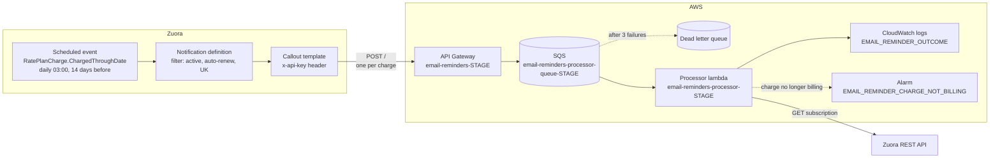

# email-reminders

Receives Zuora callouts ahead of subscription billing dates and works out which reminder or notice email, if any, each subscriber is due.

Current status: work in progress. No emails are sent; the processor only logs what it would send.

## How it works



1. A Zuora scheduled event on `RatePlanCharge.ChargedThroughDate` runs daily at 03:00 (London) and sends a callout for each charge billing in 14 days, filtered to active, auto-renewing UK subscriptions.
2. API Gateway (`email-reminders-STAGE`) checks the API key and puts the request on the `email-reminders-processor-queue-STAGE` queue as-is.
3. The processor (`email-reminders-processor-STAGE`) validates each callout; invalid ones are retried and end up on the dead letter queue, which alarms. It reads the queue in batches of up to 100 and fetches each subscription in the batch once. A subscription gets one callout per charge, so only the callout for the first charge billing on that date (the lowest charge number) is processed.
4. It classifies the billing date and logs an `EMAIL_REMINDER_OUTCOME` line.

If a callout's charge no longer bills on the date (the subscription changed in between), it logs `EMAIL_REMINDER_CHARGE_NOT_BILLING`, which triggers an alarm.

## URLs

- CODE: https://email-reminders-code.support.guardianapis.com/
- PROD: https://email-reminders.support.guardianapis.com/

Requests need an `x-api-key` header. In Zuora it is set as a custom header on the callout template.

## Zuora configuration

The scheduled event, callout template and notification definition are created or updated by a script. Existing objects are matched by name, so it is safe to re-run. Get the API key from the `email-reminders-key-STAGE` API Gateway key, then:

```sh
STAGE=CODE CALLOUT_API_KEY=... pnpm configure-zuora           # dry run
STAGE=CODE CALLOUT_API_KEY=... pnpm configure-zuora --apply --active
```

The lambdas only need to read subscriptions, but the script needs Zuora Events & Notifications permissions. The shared support-service-lambdas OAuth client only has them in CODE, so for PROD ask an admin to create a temporary OAuth client under your Zuora user (Settings > Administration > Manage Users), pass it as `ZUORA_CLIENT_ID` and `ZUORA_CLIENT_SECRET`, and delete it afterwards. With these set, the script needs no AWS credentials; otherwise it uses the `membership` AWS profile.

Without `--active` the event and notification definition are left inactive. The event runs daily at 03:00 in the Zuora tenant time zone (`runAt` in the script). It can only be set via the API, so for a test run change `runAt`, re-run the script, then revert it.

## Testing

Run `pnpm test` in this directory.

To send a callout to CODE as Zuora would:

```sh
curl -i -X POST https://email-reminders-code.support.guardianapis.com/ \
  -H "x-api-key: $API_KEY" -H "Content-Type: application/json" \
  -d '{"subscriptionNumber":"A-S00123456","accountNumber":"A00123456","chargeNumber":"C-00123456","chargedThroughDate":"2026-12-09"}'
```

## References

- [Zuora custom scheduled events](https://docs.zuora.com/en/zuora-platform/extensibility/events-and-notifications/custom-scheduled-events/custom-scheduled-event-overview)
- [Zuora callout notifications](https://docs.zuora.com/en/zuora-platform/extensibility/events-and-notifications/notifications/callout-notification-overview)
- [Zuora notification definition API (filter rules)](https://developer.zuora.com/v1-api-reference/api/notifications/post_create_notification_definition.md)
